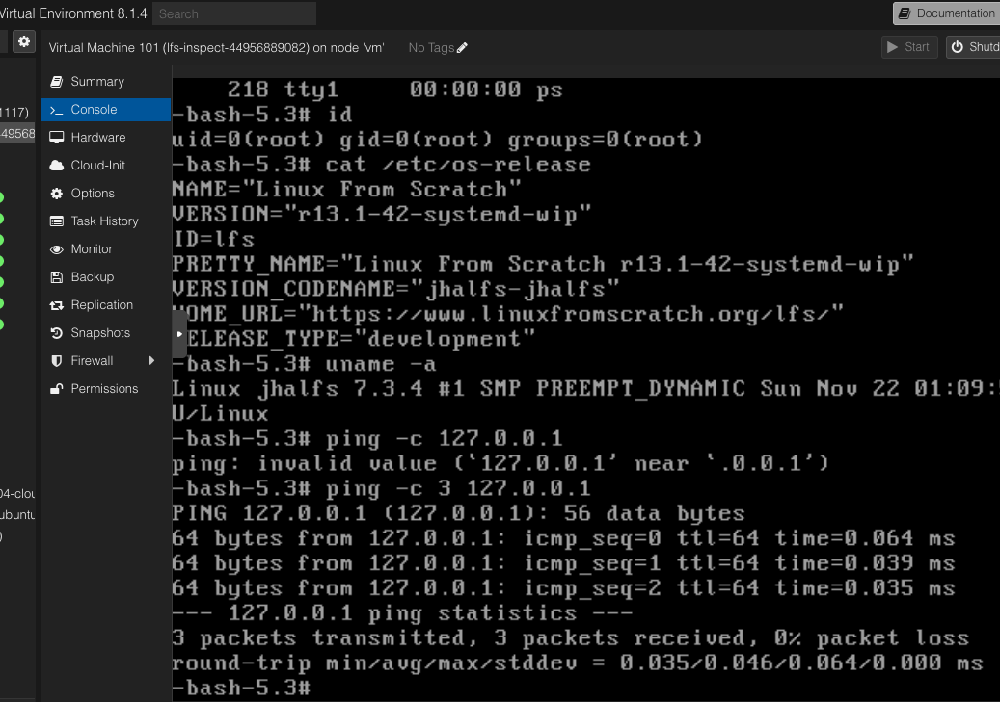

# Linux From Scratch on Proxmox

The `linux-proxmox` GitHub Actions workflow builds a bootable systemd
[Linux From Scratch](https://www.linuxfromscratch.org/lfs/) disk image using
[jhalfs](https://www.linuxfromscratch.org/alfs/). A self-hosted macOS runner
coordinates the build over SSH. Disposable Linux VMs on Proxmox run the
privileged Docker build, save checkpoints, and test the final image with QEMU.
The Mac needs the runner and SSH tools. Docker, Compose, QEMU, and Expect are
installed in the Proxmox builder template.

Follow the [runner setup](#install-the-local-proxmox-runner) for a new deployment,
or [run the workflow](#run-the-github-actions-workflow) if the runner and
Proxmox host are already configured.

## Build results

The baseline and 12-job builds passed. The exported 12-job image also booted
in a separate Proxmox VM. See the [validation results](docs/proxmox-design.md#implementation-status)
for both runs.



*The image produced by the 12-job build running in Proxmox. The console shows
the LFS release, the running kernel, and a successful loopback ping.*

On the reference Proxmox server, the full workflow took **about 3 hours
(2 h 49 min)** with 12 compile jobs in a VM with 12 vCPUs and 16 GiB RAM.
That includes the automated boot test and final disk image export.

## Prerequisites and deployment assumptions

The Mac coordinates the build; the Linux VM does the compilation. Docker and
QEMU are needed **in the builder template**, not on the Mac. Vagrant is not
required; `/vagrant` is an upstream container mount path.

| Component | Required setup |
| --- | --- |
| Proxmox | An x86-64 Proxmox VE host, reachable from the Mac by SSH; administrator access for one-time setup |
| Base cloud-init template | Ubuntu 24.04, example VM **9000**; this is the starting point for template maintenance |
| Prepared builder template | Example VM **9001**, stopped and converted to a Proxmox template after updates, tool installation, reboot, and identity cleanup |
| Template hardware | Root disk **`scsi0`**, cloud-init drive **`ide2`**, QEMU guest agent enabled, virtual serial console; no passthrough devices, host shares, or host hooks |
| Template guest | User **`ubuntu`**, passwordless sudo, working cloud-init and QEMU guest agent; Docker, Compose, QEMU, Expect, Git, curl, and CA certificates installed |
| Disposable builder slot | Example VM **9100**, reserved exclusively for this project; it must not be an existing valuable VM |
| Build resources | Reference: **12 vCPUs, 16 GiB RAM, 100 GiB disk**; compile job count is separate from VM CPU count |
| Active VM storage | Reference: **`local-lvm`**, SSD-backed |
| Checkpoint storage | Reference: **`data-zfs`**, HDD-backed, with files under **`/data/lfs-proxmox`**; never mounted into the guest |
| Network | A private bridge with no physical uplink or other VMs; administrator-installed rules allow public downloads and block guest access to host/LAN destinations |
| Local runner | A repository-scoped macOS runner, on the local network, with label **`lfs-proxmox`**; Python 3.10+, Git, GitHub CLI, curl, and OpenSSH |
| Downloads | Internet access for runner installation, container images, the book, and package sources; use an unmetered connection |

The VM pool must have room for the 100 GiB builder **plus a 100 GiB reserve**.
Checkpoint writes retain a separate 100 GiB filesystem reserve. Allow substantial
checkpoint capacity across runs and remove obsolete checkpoints as an administrator.
The Mac also needs space for the finished image, with a 10 GiB reserve.

### Names, addresses, and paths

These are reference defaults, not discovery rules. Configure different values
through the installer and private deployment settings; do not edit upstream
build scripts to change a hostname or VM ID.

| Setting | Reference value or convention |
| --- | --- |
| Proxmox hostname in public examples | `pve.example`; replace it with your own reachable hostname |
| Base / prepared template names | `ubuntu-2404-cloudinit` / `lfs-builder-ubuntu2404` |
| Build VM name | Generated: `lfs-RUN_ID-ATTEMPT-STAGE`; the same VM ID is reused sequentially for the six stages |
| Private bridge / uplink | `vmbr99` / `vmbr0` |
| Private subnet / gateway / guest | `172.30.240.0/24` / `172.30.240.1` / `172.30.240.10` |
| Guest DNS | Public resolvers `1.1.1.1` and `9.9.9.9`; the guest does not use private LAN DNS |
| Runner name / label | `macbook-lfs-proxmox` / `lfs-proxmox` |
| Runner installation on Mac | `~/.local/share/lfs-proxmox/runner` |
| Restricted provisioning key on Mac | `~/.config/lfs-proxmox/runner_key`; keep private and outside Git |
| Finished artifacts on Mac | `~/.local/share/lfs-proxmox/artifacts/RUN_ID-ATTEMPT/` |
| Proxmox administrator configuration | `/etc/lfs-proxmox/config.json` and `/etc/lfs-proxmox/rules.nft` |
| Proxmox checkpoints / active-run marker | `/data/lfs-proxmox/cache/` / `/data/lfs-proxmox/active.json` |
| Guest checkout / container mount | `/home/ubuntu/lfs-cicd` / `/vagrant` |

The broker reads its VM ID, template, storage, addresses, and resource limits
from root-owned configuration. Workflow inputs cannot override those resources.
Never attach another VM or a physical uplink to the private build bridge.
The installer requires per-interface forwarding on the chosen uplink; it does
not enable the global forwarding switch. See the [administrator runbook](docs/proxmox-runbook.md).

## Install the local Proxmox runner

1. Install Python 3.10 or newer and the GitHub CLI (`gh`) on the Mac, then
   authenticate with `gh auth login` using an account permitted to manage this
   repository's runners and Actions variables.
2. Complete the [Proxmox administrator setup](docs/proxmox-runbook.md#one-time-proxmox-administrator-setup), including
   the builder template, isolated bridge, restricted provisioning key, and
   trusted Proxmox SSH host key. Keep the private key outside the checkout.
3. From this repository, install the dedicated runner. Replace the example
   repository and hostname with your own:

   ```sh
   python3 scripts/proxmox/install-runner.py \
     --repo OWNER/REPOSITORY \
     --proxmox-host pve.example \
     --key-path "$HOME/.config/lfs-proxmox/runner_key"
   ```

The installer detects Apple Silicon or Intel, downloads the official GitHub
runner, verifies its SHA-256 checksum, and registers it with the `lfs-proxmox`
label. It installs and starts a per-user macOS LaunchAgent **without sudo**.
Its default directory is `~/.local/share/lfs-proxmox/runner`, separate from any
organization runner. It does not replace or reconfigure existing runners.
Registration tokens are not printed or saved by the installer.

With `--proxmox-host`, it first checks the restricted connection and sets these
repository Actions variables: `LFS_PROXMOX_HOST`, `LFS_PROXMOX_KEY_PATH`, and
`LFS_PROXMOX_ARTIFACTS`. Only the key's local path is configured; the private key
is not uploaded to GitHub. Site-specific settings stay out of public source.

Keep the Mac logged in, powered, and connected to the network. The build step
prevents idle sleep. To manage only this runner:

```sh
cd "$HOME/.local/share/lfs-proxmox/runner"
./svc.sh status
# ./svc.sh stop
# ./svc.sh start
```

Use trusted manual workflow revisions; do not enable untrusted fork pull requests
on this local runner. A personal repository needs its own registration;
organization runners do not serve repositories outside their organization.
See [GitHub's runner setup guide](https://docs.github.com/en/actions/how-tos/manage-runners/self-hosted-runners/add-runners)
and the [full Proxmox runbook](docs/proxmox-runbook.md).

## Run the GitHub Actions workflow

1. In the repository on GitHub, open **Actions → linux-proxmox → Run workflow**.
   The [workflow definition](.github/workflows/linux-proxmox.yaml) must be on the
   default branch for manual dispatch.
2. Select `smoke` for the first run. It checks builder VM creation, isolation,
   and cleanup.
3. After the smoke test passes, dispatch again with mode `build`. Leave
   `compile_jobs` blank for the upstream default, or enter `12` to reproduce
   the parallel trial on a suitably sized builder.
4. Follow the run in GitHub Actions. The workflow runs all six stages, tests
   that the image boots, and exports it to the Mac runner.

The finished disk is `build_dir.img` under
`LFS_PROXMOX_ARTIFACTS/RUN_ID-ATTEMPT/` on the Mac. The default artifact root is
`~/.local/share/lfs-proxmox/artifacts`. Intermediate checkpoints stay on
Proxmox. To boot the exported image in a separate VM, follow the
[Proxmox console inspection steps](docs/proxmox-runbook.md#inspect-the-final-image-in-proxmox).

## Returning after a few months

1. Read this section and the [implementation status](docs/proxmox-design.md#implementation-status).
   Template 9001 being stopped is normal. VM 9100 and `active.json` being absent
   while idle is also normal; the workflow creates and removes the builder.
2. On the reference Mac, find the actual private deployment inventory at
   `~/.config/lfs-proxmox/deployment.json`. It records local names and paths,
   not private-key contents. A fresh clone will not contain this private file;
   the repository Actions variables and Proxmox administrator configuration are
   the other sources of truth. Back up the inventory and key outside Git.
3. Check the template and storage in Proxmox: `qm config 9001` and `pvesm status`.
   Confirm the template, agent, storage, and free space before building.
4. Check the Mac runner from its installation directory: `./svc.sh status`.
   In repository **Settings → Actions → Runners**, it should be online and have
   the `lfs-proxmox` label. Check the three Actions variables listed in the
   [runner setup](#install-the-local-proxmox-runner).
5. In **Actions → linux-proxmox**, run `smoke` before `build`. Keep the Mac logged
   in, powered, and connected. Do not rerun first-time host installation over a
   working deployment or disable isolation guards to bypass an error.
6. Find the completed disk at `RUN_ID-ATTEMPT/build_dir.img` under the
   configured artifact directory. Intermediate checkpoints are on Proxmox.
   Inspect GitHub Actions logs for failures; use a short tail first.

## Upstream reference

The [upstream GitHub Actions workflow](.github/workflows/linux-gha.yaml) and build
scripts are preserved. The [manual Docker reference](docs/upstream-docker.md)
covers the original local procedure.
